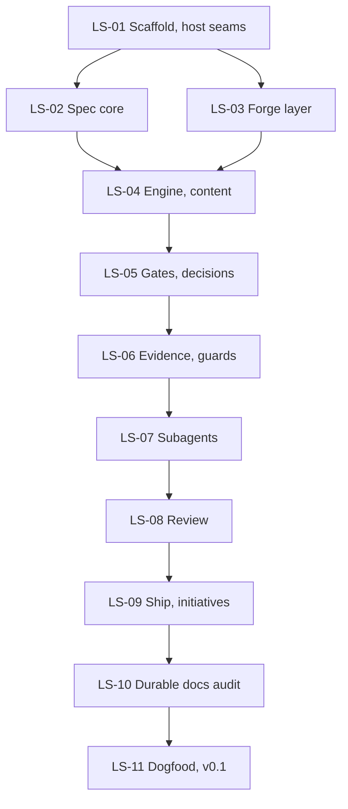

# Roadmap

The work is split into specs. Each spec is one GitHub issue, one OpenSpec change (built with pi-superspec) and one pull request. Each issue contains everything needed to start its change. Build them in order: when each spec is done, the package still works.

Sizes: **M** is a few tasks, **L** many. They compare specs and are not time estimates.

## Specs

| Spec | Issue | OpenSpec change | Size | Depends on |
|---|---|---|---|---|
| LS-01 Scaffold and host seams | [#1](https://github.com/ttdua/pi-livespec/issues/1) | `scaffold-and-host-seams` | M | — |
| LS-02 Spec core: living spec and change issue formats | [#2](https://github.com/ttdua/pi-livespec/issues/2) | `spec-core` | L | LS-01 |
| LS-03 Forge layer: GitHub and Gitea | [#3](https://github.com/ttdua/pi-livespec/issues/3) | `forge-layer` | L | LS-01 |
| LS-04 Engine, flow pack and agent-skills content | [#4](https://github.com/ttdua/pi-livespec/issues/4) | `engine-and-content` | L | LS-02, LS-03 |
| LS-05 Gates, questions and decision points | [#5](https://github.com/ttdua/pi-livespec/issues/5) | `gates-and-decisions` | L | LS-04 |
| LS-06 Unit evidence loop and guards | [#6](https://github.com/ttdua/pi-livespec/issues/6) | `unit-evidence-and-guards` | L | LS-05 |
| LS-07 Subagent dispatch, context packets and parallel lanes | [#7](https://github.com/ttdua/pi-livespec/issues/7) | `subagent-dispatch` | L | LS-06 |
| LS-08 Review fan-out and finding routing | [#8](https://github.com/ttdua/pi-livespec/issues/8) | `review-and-findings` | L | LS-07 |
| LS-09 Ship, small-fix lane and initiatives | [#9](https://github.com/ttdua/pi-livespec/issues/9) | `ship-and-initiatives` | L | LS-08 |
| LS-10 Durable docs and drift audit | [#10](https://github.com/ttdua/pi-livespec/issues/10) | `durable-docs-audit` | M | LS-09 |
| LS-11 Dogfood and v0.1 release | [#11](https://github.com/ttdua/pi-livespec/issues/11) | `dogfood-release` | M | LS-01 to LS-10 |

LS-02 and LS-03 can be built in parallel. After that, the order is a chain.

## What works after each spec

| After | You can |
|---|---|
| LS-02 | Validate `specs/` and migrate from `openspec/specs` |
| LS-04 | Open any session mid-change and see the right next step |
| LS-06 | Build a change inline with receipts, gates and guards |
| LS-08 | Build and review a change with subagents |
| LS-09 | Ship changes and run initiatives end to end |
| LS-11 | Install v0.1 |

## After v1

- **Jev decisions.** Decision points gain `mode: jev`, with the v1 rule as fallback ([ADR 0006](decisions/0006-rule-based-decisions.md)). This needs a separate change in pi-jev-pilot: Score questions in `QuestionSpec` and a `jev:ask` seam on `pi.events`. The order:
  1. `lane`, `tags` and `durable-docs` first;
  2. then replay the decision records collected in v1 and tune the thresholds;
  3. then `difficulty`, `progress` and `drift-severity`.
- Offline mode with a local file queue.
- GitLab and Forgejo adapters.
- Stacked pull requests.
- Risk-case analysis and pre/post/HEAD replay in worktrees.
- A Superpowers flow pack.
